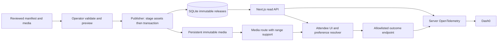

# Implementation handoff: Adaptive Conference

Design review · November 7, 2026 · Documentation only; no application has been implemented.

**Build an application that presents the same conference information according to an attendee's communication preferences and strengths.** The core proof is a picture-led agenda, prepared signing in a named language, and accessible text/screen-reader navigation. Layout switching and schedule updates support that proof.

This is the implementation entry point. The owner's [product vision](./PRODUCT_VISION.md) defines intent; this document resolves implementation choices and supersedes older technical/scope proposals in the [pitch](./PITCH_DECK.md), [operations exploration](./CONFERENCE_OPERATIONS_PLAN.md), and [track analysis](./TRACK_INTEGRATION_ANALYSIS.md). The [demo strategy](./DEMO_STRATEGY.md) defines presentation priorities; the [setup record](./INTEGRATION_SETUP.md) distinguishes verified infrastructure from unbuilt features. Technical defaults here are design recommendations selected for handoff, not additional owner requirements.

## Owner decision update

ASL (American Sign Language) is confirmed for the first demo. The hackathon environment is the preferred deployment target, pending confirmation during the event; local Docker/Radar remain development/test options. Coding start and deadline are yet to be determined, so this update does not authorize starting main coding. The ASL media source, permission, and fluent reviewer are still unresolved.

## 1. Review verdict and gaps

**Ready to start implementation against the contracts below. Not ready to claim a complete signed-agenda experience.** Permitted ASL content and fluent review remain external dependencies; the language decision is resolved. The application skeleton, publication logic, accessible navigation, and picture-led interface can proceed independently; placeholder clips cannot close the signed-content gap.

| ID | Severity | Gap found | Resolution / release gate |
| --- | --- | --- | --- |
| G01 | Blocks signed-content completion | ASL selected; content source and reviewer still unresolved | Obtain permitted ASL content plus fluent review; record the content manifest in section 5. Do not reopen the language decision. |
| G02 | Core design gap | Adaptation described as layouts/toggles without selection semantics | Separate communication formats, language, and density; deterministic selection contract in section 4. |
| G03 | Core design gap | Accessible formats could sit behind text-heavy onboarding | Preview pictures and signing directly on entry; accessible text/keyboard path throughout. No diagnosis questionnaire. |
| G04 | Core design gap | Pictures might be decorative while the task still requires dense reading | Define comprehension tasks and meaningful picture sequences; validate with participants before claiming effectiveness. |
| G05 | Correctness gap | Media could repeat obsolete room/time facts or room details | Hash all source facts the representation depends on, review that hash, and bind eligible content to an immutable release. |
| G06 | Correctness gap | Undefined atomic boundary between assets and SQLite | Stage and verify immutable assets first; commit snapshot and active pointer together. Crash rules in section 6. |
| G07 | Correctness gap | Polling/cache/race behavior unspecified | Explicit versioned API, no-store responses, request ordering, and honest freshness states in sections 7–8. |
| G08 | Scope/security gap | Organizer authentication, upload, and dashboard unspecified | First release uses a trusted operator CLI and read-only attendee APIs. Public organizer UI is a separate feature gate. |
| G09 | Delivery gap | Native SQLite packaging, runtime, and rollout unspecified | Node 24 LTS baseline, pinned dependencies, native-driver container smoke test, one replica, Recreate rollout, durable local/block storage. |
| G10 | Delivery gap | Assets bundled only in an app image could disappear after rollback | Store published immutable assets alongside database on the persistent volume; no startup reseeding or automatic asset deletion. |
| G11 | Privacy/integration gap | Browser evidence could expose tokens or communication preferences | Allowlisted anonymous outcome events through a constrained same-origin endpoint; server exports to Dash0. No generic telemetry proxy. |
| G12 | Product boundary gap | All seven communities could be mistaken for seven disability presets | Shared accessible experience for everyone; optional community discovery is separate, with no identity-to-format mapping. |
| G13 | Scope gap | Older documents disagree on audio, six sessions, AI, and eight-hour plan | Three-session default, prepared media only, optional audio, no AI, protected verification time; this document takes precedence. |
| G14 | External dependency | Public host, event storage, and final submission logistics unverified | Validate assigned environment at kickoff. Local Radar cluster is an implementation/test target, not an existing public app. |

“Resolved” here means specified in the design. Every implementation gate still needs evidence.

## 2. Bounded first release

- **Audience:** all seven communities in the product vision; support is chosen by each attendee. Do not claim that every community's needs have been researched or satisfied.
- **Fixture:** one fictional public conference, one day, three sessions, two rooms, one written language, and ASL as the supported sign language. Review content for all three sessions. If necessary, shrink the actual fixture to one complete session; do not label partial signing coverage as a fully signed three-session agenda.
- **Core:** guest event URL, direct format previews, picture-led/signed/accessible-text representations, persistent preference controls, exact session/room/time facts, prepared-content availability states, and keyboard/screen-reader access.
- **Authoring:** a reviewed local manifest and media files, validated/imported/published by an operator command. No public writes, web upload, real roster, or accounts in the core.
- **Next:** bookmarks, density variants, QR convenience, then organizer UI and a prepared update if they fit. The underlying data/publication code supports later changes from the beginning.
- **Optional:** prepared audio, community-resource links, typed communication cards. No custom speech generation; assistive technology reading semantic text remains normal user-controlled access.
- **Deferred:** live interpretation/transcription, generated signing, AI companion, Elasticsearch, push notifications, offline synchronization, real attendee profiles, multilingual expansion, and multi-organizer administration.

Target the current Chrome desktop/mobile experience and Safari on iOS for media playback; record actual tested versions. Use Safari + VoiceOver on the available Mac for the manual assistive-technology check. Browser coverage beyond actual tests is unverified.

## 3. Architecture and implementation boundaries



Use one Next.js App Router application with TypeScript and React, Node runtime for server routes, SQLite through `better-sqlite3`, and one process/container serving UI, reads, and media. Use a runtime schema validator such as Zod at manifest/API boundaries; do not rely on TypeScript types for untrusted input. Keep raw SQL and a small repository layer; no ORM, worker queue, or microservices are needed for this fixture.

Use Node **24 LTS**, pin an exact maintained patch and compatible package versions at scaffold time, and commit the lockfile. The previously verified local Node 25 installation is not the runtime baseline: the [official release table](https://nodejs.org/en/about/previous-releases) now lists it as EOL. No host runtime has been changed by this review.

The [driver documentation](https://github.com/WiseLibs/better-sqlite3) and [Next.js external-package guidance](https://nextjs.org/docs/app/api-reference/config/next-config-js/serverExternalPackages) inform packaging. Build dependencies inside the Linux target container, not by copying macOS dependencies. First smoke test must open a database, commit a release, and serve a clip using the production image. Resolve exact Next.js/React/OTel compatibility in this first gate; do not invent a tested version combination in advance.

Suggested modules, all still to be created:

| Boundary | Responsibility |
| --- | --- |
| `domain/contracts`, `domain/representation-selector` | Pure schemas, source dependencies, selection, availability, and timezone rules |
| `server/db`, `server/publisher` | Migrations, immutable snapshots, compare-and-swap publication, asset validation |
| `server/media`, `server/telemetry` | Safe streaming, bounded outcome ingestion, sanitized exports |
| `components/preferences`, `agenda`, `session`, `media` | Semantic controls and format-specific presentation using shared facts |
| `scripts/content` | Validate, preview, publish, export; imports server domain logic directly |
| `fixtures`, `tests` | Reviewed synthetic content and focused contract/integration/browser tests |

Server-only modules must not be imported by client components. Do not use an Edge runtime for SQLite/filesystem operations.

## 4. Data and preference contracts

### Persistence model

Keep the small agenda as a validated JSON snapshot rather than a large normalized CMS. All IDs are opaque and event-scoped; room/session references must resolve within the same conference.

| Record | Required fields / constraints |
| --- | --- |
| `conferences` | `id`, unique `slug`, `activeRelease` (null before first publication) |
| `releases` | Composite key `(conferenceId, releaseNumber)`; `schemaVersion`, `createdAt`, `bundleJson`, `bundleHash`; immutable after commit |
| `assets` | `sha256`, validated MIME, byte length, relative storage key; immutable bytes. Only assets referenced by published releases are publicly served. |
| `publication_requests` | `(conferenceId, requestId)` unique, input hash, resulting release; permits safe retry of the same operator command |
| `schema_migrations` | Migration version; migrations never reset existing conference content |

Snapshot contract:

- `conference`: stable ID, title, IANA timezone, event date, help details, written-language availability, approved sign-language choices.
- `rooms[]`: stable ID, name, factual location guidance, optional verified image references and descriptions. No invented route/accessibility facilities.
- `sessions[]`: stable ID, title, start/end instants with offset, room ID, short plain-language summary, optional speaker and fuller description.
- `representations[]`: `id`, subject type/ID (session or event orientation), `format` (`pictures`, `sign`, optional `audio`), written/sign-language identifier as applicable, `sourceHash`, `availability`, and structured payload/asset references.
- `coverage`: required formats/languages for the declared demo scope, plus per-session availability. Computed during validation, never a hand-authored “100%” claim.
- `changes[]`: precomputed field changes from the previous release, if any, including previous/new values. No client-side schedule diff.

Every session has authoritative text facts; text is not an optional media asset. A pictures payload is an ordered list of `{assetHash, shortLabel, description}` tied to the same facts. A sign/audio payload includes the reviewed asset hash and equivalent text/script. Separate private provenance (reviewer contact, permission evidence) from public display metadata; exclude private fields when constructing the public bundle.

Persist representation availability as `available`, `not_prepared`, or `awaiting_review`. An available representation requires a matching reviewed source hash and valid assets. A stale hash is a validation error, not a fourth playable state. Network/codec failures are transient client states, not edits to the published record. Label the selected sign language from a small approved catalog; its identifier is separate from the written-language locale. Format event times in the event's explicit timezone, with the date visible where needed; never silently use the device timezone.

Store a canonical public JSON serialization for each release, and compute `bundleHash` from those exact UTF-8 bytes, excluding the hash field itself. Return the hash in the current-pointer response, not inside the bytes it hashes. Database and payload release/event IDs must agree. Do not include private review evidence in those bytes. Enforce the active-release reference and uniqueness constraints in the database as well as the validator.

For the small fixture, compute `sourceHash` over a deterministic serialization of the entire session, its referenced room, and relevant event title/timezone/help facts. This deliberately over-invalidates some media when room wording changes; it avoids silently stale references. Orientation content hashes its relevant event fields. Record a canonicalization version, sort object keys, preserve meaningful array order, and normalize timestamps before hashing. The content preparer reviews this exact source hash. Publication fails if an asset marked available was reviewed against different facts.

### Preferences: device-local, independent dimensions

```ts
type PreferencesV1 = {
  schemaVersion: 1;
  primaryFormat: 'text' | 'pictures' | 'sign';
  showPicturesAlongside: boolean;
  signLanguage: string | null; // approved catalog identifier, not guessed from locale
  writtenLanguage: string;
  density: 'standard' | 'focus';
  offerPreparedAudio: boolean;
};
```

Accessible text facts remain reachable in every presentation. Primary format controls emphasis; it does not remove essential semantic information. Show both signing and pictures when requested and available. Do not silently pick a different sign language. `offerPreparedAudio` exposes controls only for matching available recordings, with an explanation when absent.

Default: accessible text, standard density, no playback, no inferred signing language. A user can immediately choose pictures or signing. Keep preferences in memory unless the attendee chooses “Remember on this device”; then store versioned preferences scoped by conference. If storage is unavailable/corrupt, preserve in-memory operation and explain that settings will not be saved. Clear-settings removes only this app's scoped keys. No attendee ID, diagnosis, community affiliation, or challenge narrative is required.

Read device settings only on the client. Server-render a neutral, accessible entry state, then apply validated settings without hydration mismatches, unwanted playback, or a flash of a diagnosis-specific screen. Persist only schema-approved preference fields; unknown fields and invalid language identifiers do not become settings.

Resolution order: current explicit choices → valid remembered settings → accessible defaults. Selection takes `(release, subjectId, preferences)` and returns ordered representations plus explicit unavailable reasons. Do not change the preference when content is missing. No language fallback for signing without user action. Never hide the session itself because its preferred representation is unavailable.

## 5. Screens and content readiness

### Attendee screens

1. **Entry `/e/:slug`:** event identity, timezone, direct picture and signing previews with labeled controls, accessible text option, available language labels, optional remember switch, and skip-to-agenda. No login wall or long questionnaire. A short signed orientation explaining entry/control choices is part of the signed journey; the first screen must not require understanding dense written instructions to find it.
2. **Agenda:** consistent time/room facts, selected representation emphasis, visible preferences control, coverage notice, freshness status. Do not load every video at once; show a poster and load on request. The agenda can show signed session cards without automatically playing them.
3. **Session:** exact title/time/room/next action, meaningful visual sequence or signed clip, text equivalent, optional room help. Player is large enough to see hands and face, resizable/fullscreen, with explicit playback; no autoplay or cropped signing space. One audio/video player at a time.
4. **Preferences:** reachable from every attendee screen, keyboard-operable and previewable; applying settings preserves selected session and any implemented bookmark. Return focus to the trigger when closing the panel. Changing away from a playing format pauses it.
5. **Unavailable/error states:** distinguish unsupported language, not prepared, awaiting review, stale source, network failure, and unsupported codec. State the limitation and offer retry or explicitly chosen alternatives. Do not label a transcript as successful signed access.

The [W3C signing guidance](https://www.w3.org/WAI/media/av/sign-languages/) informs discoverability, language selection, recording quality, and player size. The [W3C images guidance](https://www.w3.org/WAI/tutorials/images/) informs meaningful image descriptions and control labels. These inform implementation checks, not a claim of WCAG conformance.

### Content manifest required before signed completion

| Item | Minimum coverage | Evidence required |
| --- | --- | --- |
| Exact event/session/room facts | All three sessions and two rooms | Source owner, timezone, review date |
| Picture-led task sequences | Every session in the declared fixture | Relevant permitted images, descriptions, short labels, factual review |
| Signed orientation | Entry and selection controls | Selected sign language, usable video, equivalent script, fluent review, permission |
| Signed session agenda clips | Every session in the declared fixture | Actual title/topic, time, room and next action conveyed; source hash, fluent review, permission |
| Optional audio | Only records claimed to support audio | Matching script/recording, review, source hash |

Record per item: `subjectId | format | language | sourceHash | assetHash | duration/size | script/description | permissionRef | reviewerRef | reviewedAt | status`. Owner/content contributor supplies content and language; implementer verifies technical integrity. A Boolean “reviewed” is only a record of human review, not automated evidence of translation correctness.

Use MP4 with a browser-tested codec for the first signing clips; verify Chrome and iOS Safari playback on the actual encoded files. Preserve signing detail while compressing. Set initial import caps of 25 MB per clip, 2 MB per picture, and 150 MB total package; these are demo engineering limits, adjustable after inspecting real media, not accessibility standards. Pre-optimize pictures; do not require runtime image generation or optimization for the basic journey.

Do not fetch remote URLs during manifest validation. Operator-provided media must be local regular files from the package root; reject traversal, symlinks escaping the root, unsupported MIME, mismatched hash/size, and active HTML/SVG uploads. The package is trusted operator input but is still validated. No public upload endpoint exists.

## 6. Preparation and atomic publishing

Implement an operator command with three operations (names are proposed interfaces, not available commands yet):

```text
content validate <package>                 # no mutation; coverage and validation report
content preview <package>                  # loopback-only preview using the same renderer
content publish <package> --expected N --request-id UUID
```

Run publication in the application container with the mounted data volume, or locally against the intended database. Access is controlled by local OS/container/Kubernetes credentials; the attendee service exposes no publishing route. The preview is never public and never alters the active release. Developer tooling must preserve this separation.

Publication algorithm:

1. Validate IDs, schema, date ranges, room references, source hashes, coverage, reviews, permitted file types, and package limits. For initial release, require all core representations for the declared fixture. Validation failure produces actionable item-level errors.
2. Copy media to temporary files on the durable volume, verify bytes/hash, flush, then atomically rename to content-addressed final paths. Reuse identical existing files after verifying hash. Never replace bytes at an existing hash. Do this before the DB write transaction.
3. Begin a short SQLite `BEGIN IMMEDIATE` transaction. Check duplicate request ID first: identical input returns the previously created release; different input is an error. Compare `expected` to the active release; mismatch is a conflict, never an overwrite.
4. Recheck asset presence, write the immutable snapshot and asset records, calculate changes once, record the request result, and advance the active pointer in the same transaction. Release numbers only increase; first expected value is 0.
5. Commit, then report success. A timed-out caller retries with the same request ID. Cleanup of unused staged assets is not part of publication and is deferred for the demo.

Asset/DB failure before commit leaves the previous version active. A crash after staging can leave orphan files, which is acceptable; it must not expose an incomplete release. Snapshot activation cannot make nonexistent media valid. A later disk/media failure is a runtime failure with visible unavailable state and diagnostics.

For a later urgent factual correction without replacement signing: require the operator to explicitly acknowledge reduced coverage and mark affected representations `awaiting_review` or `unavailable`; never permit a stale asset to remain available. Block initial full-demo publication with missing core coverage. Do not delay current facts solely to keep old media playable. The interface explains the gap, and the release no longer qualifies for a complete signed-update claim. Republish older facts as a new release if intentionally correcting them; never decrement the active version.

## 7. Read API contract and media serving

All public event content is read-only. JSON responses include `schemaVersion`. Failures use `{error: {code, message, requestId}}` with no stack traces or private filesystem paths.

| Route | Contract |
| --- | --- |
| `GET /api/events/:slug/current` | `{conferenceId, releaseNumber, bundleHash, publishedAt}`; 404 if no published event |
| `GET /api/events/:slug/releases/:n` | Exact immutable public snapshot, including its release number and schema version; 404 for absent/event-mismatched release |
| `GET /media/:sha256` and `HEAD` | Only validated published assets; correct MIME/length, byte-range support for video, 404 if unknown, 416 for invalid range |
| `GET /health/live` | Process can serve; no upstream-service dependency |
| `GET /health/ready` | DB/schema usable, active release readable, required mounted directories accessible; 503 while unavailable |
| `POST /api/client-events` | Optional bounded operational outcomes only; described in section 10; cannot change conference data |

Use request-time reads and `Cache-Control: no-store` for both current and snapshot JSON in this small prototype. Client fetches also use no-store; no service worker or ISR for conference data. Hash-addressed media can be `public, max-age=31536000, immutable`, with `nosniff`; missing-asset errors must not be cached as success. Framework and proxy behavior must be verified in the production build, following [Next.js self-hosting guidance](https://nextjs.org/docs/app/guides/self-hosting).

Resolve media only from a validated asset record under the configured asset directory, never an arbitrary user path or upstream URL. Support GET/HEAD, a single valid byte range and standard 200/206 responses, stream bytes rather than buffering a whole clip, and close streams on disconnect. Reject malformed/multiple ranges consistently. Verify seeking and replay in real browsers.

## 8. Freshness, loading, and state transitions

Initial load: read current pointer → load that exact snapshot → schema/hash/version validation → display one complete release. Never merge fields from two releases. If a newer pointer appears while loading, keep one internally consistent snapshot and immediately fetch the newer release; label updating until checked. Abort obsolete requests and reject completions older than the displayed release or belonging to a previous event.

Poll current every five seconds while visible and online, using one request at a time and a timeout. Refresh immediately on focus/visibility restoration or reconnect. Preserve selected session and preferences across replacement; if a session disappears, show an explanation and return to the agenda instead of silently selecting another session. Media need not all download before showing the new snapshot: each player/card has its own pending/error state and coverage indicator.

| State | User-facing behavior |
| --- | --- |
| No successful load yet | Accessible loading state; on failure show retry, not an empty agenda |
| Latest successful check | “Last checked …” with current displayed release; no promise of instantaneous updates |
| New release downloading | “Updating”; keep previous snapshot visibly identified until complete replacement |
| Poll or snapshot failure / offline | Keep last loaded content in memory with “May be out of date”; retry when appropriate |
| One asset fails | Other content remains usable; pause failed media, explain unavailability, provide retry |
| Release changes during playback | Pause affected player and explain updated information; never resume obsolete signing/audio automatically |

Do not steal focus or repeatedly announce unchanged status every poll. Use a persistent, concise update message and one appropriate live-region announcement on meaningful state changes. No background push or durable offline-access promise. On a fresh offline reload, only a retry state may be available.

The optional update target is under ten seconds from publication initiation to matching visible release in a controlled visible/online browser test, measured using one runner clock. It is not a production SLA. Version comparisons and current-time calculations are allowed; attendee-triggered generation and full schedule diffs are not.

## 9. Deployment, storage, and recovery

- One Node application replica, no HPA, deployment strategy `Recreate` so an old and new app do not overlap during replacement. Short downtime is expected and visible through freshness/error states.
- Mount durable data at `/data`: database `/data/conference.sqlite`, assets `/data/assets`. Never keep writable conference state only in the image or Next.js build cache. Run as a non-root user with verified volume permissions.
- Use a pinned Linux Debian-based Node 24 image and build for the target node architecture. Set `DATABASE_PATH`, `ASSET_DIR`, `APP_ORIGIN`, `SERVICE_VERSION`, and server-only telemetry environment variables. Keep tokens in Kubernetes Secrets; do not embed them in the image or `NEXT_PUBLIC_*` values.
- SQLite: foreign keys enabled, WAL on verified compatible local/block storage, bounded busy timeout (initially five seconds), short write transactions. [SQLite documents](https://www.sqlite.org/wal.html) that WAL requires same-host shared-memory access and is unsuitable for a network filesystem. Inspect the actual storage class; a PVC name alone does not prove suitability.
- Preferred demo environment: the supplied hackathon environment, pending owner confirmation during the event. Use the existing local `k3d-adaptive-conference-cluster` and Docker for development/testing where useful, with the app in its own namespace. At kickoff, validate the supplied event cluster, image access, architecture, storage semantics, namespace, public TLS URL, and expiry before deployment. No cluster installation/change is performed by this handoff.
- Migrate explicitly before serving; seed/import only by explicit operator command. On every restart, retain existing content. Pin app schema compatibility; application rollback is allowed only when it can read the existing schema. Do not restore old conference facts merely to roll back code.
- Snapshot/export the DB with a supported SQLite backup mechanism plus all referenced immutable assets; do not copy only a live WAL database file. Demonstrate restoration to a fresh temporary volume before claiming recovery. Keep demo assets until event completion; no automatic garbage collection.
- Readiness should not depend on Dash0 availability. On shutdown, finish/roll back active publication and flush telemetry with a bounded timeout. Failure of telemetry must not block conference access.

The current local cluster has no public application URL. A durable public host and post-event budget remain owner decisions; event-day success must not imply permanent hosting.

## 10. Meaningful tool integrations

**Gitar:** use from the first implementation PR, publish the [review rules](../.gitar/review/conference.md), and capture an actual review/fix/check. Priorities are source/version correctness, authorization boundaries, media fallback, accessible controls, and persistence. Code review does not certify signing or picture comprehension.

**Dash0:** one server OpenTelemetry initialization path; direct OTLP export using the verified endpoint and a server secret. Trace `content.validate`, `content.publish`, `release.read`, and normalized media delivery operations. Record bounded outcomes/latency and deployment version; content release IDs may appear in traces, not unbounded metric labels. Inspect the locked Next.js instrumentation startup path before wiring the SDK; avoid duplicate auto/manual server instrumentation.

For minimal client evidence, send `{event: 'release_rendered' | 'media_ready' | 'media_failed', releaseNumber, readRequestId, outcomeCode}` to the same-origin endpoint after actual UI commit or media readiness/error. Allowlist fields/enums, validate an existing release and bounded request ID, cap a request at 2 KB, rate-limit at the proxy/application, reject other origins, and never forward arbitrary attributes/URLs/OTLP payloads. Treat events as untrusted client reports, not proof a human understood the content. Instrument receipt server-side and correlate with the returned read request ID. No cross-session user identifier is needed.

Do not emit individual format choices, sign language, diagnoses, community interests, raw URLs/query strings, local preferences, media payloads, or request bodies. Normalize `/media/:sha256` spans to a route template and scrub request headers/cookies. Check automatic instrumentation for leaks. Report content coverage from operator publication metadata, not attendee profiles. If telemetry is disabled or fails, UI behavior is unchanged. Add a browser SDK only as a separately validated enhancement; [OpenTelemetry's browser guidance](https://opentelemetry.io/docs/languages/js/getting-started/browser/) currently describes browser instrumentation as experimental. This minimal endpoint is not a claim of complete frontend monitoring or automatic sponsor eligibility.

**Radar:** inspect the deployed image, pods, events, volume mounts, and restart behavior. A useful bounded scenario is a failed media-directory mount or a deliberately failed readiness check in the demo environment, then correction and verified media retrieval. Record that injected faults are synthetic. Separate application assertions (same active release and asset hashes after replacement) from Radar health evidence. No fault injection is needed during this design review.

## 11. Acceptance and implementation sequence

Create the following checks during implementation. Documentation review is not evidence that they pass.

| ID | Check | Pass condition |
| --- | --- | --- |
| A01 | Source/schema validation | Invalid time/room references, cross-event IDs, missing facts, wrong source hash, unsupported file, and missing required signing fail with item-level errors |
| A02 | Selection matrix | Text, pictures, signing, combined choices, unsupported language, unreviewed/stale/missing content produce the specified results without changing user choice |
| A03 | Publication failures/retry | Failure before commit leaves old release; two publishers with the same expected version cannot overwrite; identical request retry returns one release; changed input with reused ID fails |
| A04 | Mixed-version race | Delay an older snapshot response while publishing/loading a newer one; UI never regresses or combines releases |
| A05 | Real media behavior | Actual signed clips play/seek in tested browsers; range/HEAD behavior works; missing/corrupt asset reports failure; update pauses obsolete media |
| A06 | Content equivalence | Reviewer verifies actual session/time/room/task conveyed in each core representation and signs off source hashes; placeholders do not pass |
| A07 | Accessible entry and navigation | Keyboard-only entry, preview, selection, agenda, player controls and return work; no trapped/lost focus; VoiceOver can access facts and meaningful state changes |
| A08 | Visual interaction | Test narrow mobile layout, 200% text zoom, visible focus, readable contrast, meaningful image descriptions, no autoplay, unobscured signing space; record automated and manual results separately |
| A09 | Persistence/privacy | Remember opt-in, corrupt/blocked storage, clear-settings and event isolation work; no profile in API/telemetry; no server secret in browser build |
| A10 | Freshness/failure | Offline/failed polling retains labeled old content; recovery loads one current release; failed media does not crash agenda |
| A11 | Deployment/recovery | Build from clean checkout, deploy pinned image, publish, replace pod, verify active release and assets; backup restores to a separate volume |
| A12 | Tool evidence | Actual Gitar result, Dash0 application events with no sensitive attributes, and Radar inspection with independent app checks; setup traces excluded |

Use unit tests for selection/hash/validation, temporary-database integration tests for transaction/retry behavior, and a small Playwright suite for real journeys/races/media failures. Pair automated accessibility checks with manual keyboard, VoiceOver, and content review. Do not create tests merely restating constants or snapshots of implementation internals.

Implementation order:

1. **Parallel readiness in the work plan (not extra agents):** owner obtains permitted ASL content and a fluent reviewer while implementer establishes Node/container/SQLite/media compatibility. Dependencies remain explicit.
2. **Data spine:** schemas, synthetic fixture, validator, staging/publisher, read APIs, focused integrity tests.
3. **Communication journey:** discoverable preferences, pictures, signing player, accessible text and navigation; real media/content gate. This is the product proof.
4. **Reliability:** errors/freshness, request races, persistent deployment, bounded telemetry and release evidence. Use Gitar and basic telemetry as these slices are built.
5. **Optional scope:** bookmarks/density/QR first, then a small organizer UI or prepared update only if core gates are green. A public organizer UI requires explicit server authentication, CSRF/origin protection, authorization and concurrency checks before any write route is exposed; hiding a button is insufficient.
6. **Release:** stop new features with at least 90 minutes left, run the bounded acceptance set, capture results, rehearse, and submit. Follow the [demo time gates](./DEMO_STRATEGY.md#build-gates-and-time-control); no promise that the full optional menu fits.

For every acceptance item record `status | commit/image | environment/browser | fixture/release | steps | actual result | limitation | evidence link`. Start as not run. The implementer owns technical evidence; the content reviewer owns meaning/translation review; the owner resolves scope/language/hosting. No participant has yet validated the proposed experience.

## 12. Remaining decisions and handoff checklist

| Decision | Default or next action | What it blocks |
| --- | --- | --- |
| Sign language / content review | ASL confirmed; source, usage permission and fluent reviewer still needed | Signed content completion; independent engineering can proceed once coding timing permits |
| Media rights and availability | Obtain permission for actual clips/images and review exact source facts | Publishing those assets and claiming complete supported formats |
| Fixture size | Three sessions/two rooms; shrink the whole fixture if content cannot be completed | Final scripts and coverage claim |
| Prepared audio | Deferred from core; add only reviewed clips if time permits | Audio feature only |
| Organizer web UI | Operator CLI is the first-release default | Dashboard is optional, not a hidden prerequisite |
| Public hosting/lifetime | Hackathon environment preferred, confirmation during event; local cluster available for development/testing | Public access and post-event availability claims |
| Coding start/deadline | Yet to be determined by owner; confirm before main coding if still unresolved | Starting implementation and setting its execution budget |
| Track submission/evidence | Prepare meaningful evidence for installed tools; verify final rules/logistics at kickoff | Track claims, not the attendee experience |

Before handing to an implementer: read sections 1–2 and the product vision; do not use the original pitch as an executable spec. Before declaring implementation complete: required A01–A11 have recorded results, content dependencies are resolved for claimed formats, tool claims have A12 evidence, and remaining limitations are visible in the README/demo. If only part is built, state that coverage explicitly.
