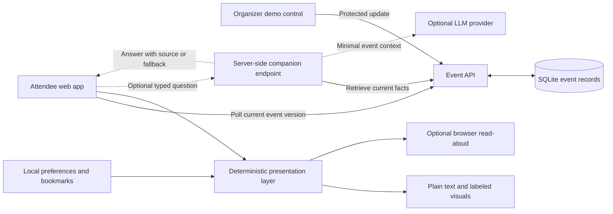

# Adaptive Conference Experience

**One conference. Information in the way that works for you.**

Historical concept deck · v0.1 · November 7, 2026  
Target: WeMakeDevs Cloud Native Hackathon — Merge Forward

Owner clarification: the core is conference information matched to attendee communication preferences and strengths, including picture-led and signed agendas. See the [current product vision](./PRODUCT_VISION.md) and [revised demo priorities](./DEMO_STRATEGY.md), which supersede narrower layout/change-notification emphasis below. The eight-hour schedule and optional runtime-audio/AI choices in this original concept are not a finalized build commitment.

> An accessible conference interface that presents the same trusted information through attendee-selected picture-led agendas, prepared sign-language content, accessible text, and optional audio, based on communication preferences and strengths.

---

**Implementation status:** Historical alternatives and estimates below are retained as concept history. Build from the [implementation handoff](./IMPLEMENTATION_HANDOFF.md): picture-led and signed agendas are core; app-generated speech and AI are excluded; fixture defaults to three sessions/two rooms; operator CLI publication precedes any organizer UI.

## 01 · Track alignment

**Official theme:** The organizer’s page names the Merge Forward track **“Conferences for Everyone”** and describes it as **“For the project that makes conferences more inclusive and accessible.”** [Official hackathon page](https://www.wemakedevs.org/hackathons/cnh), checked November 7, 2026.

**Our proposal:** Reduce communication barriers when attendees find sessions, understand changes, and decide what to do next. Neurodivergent accessibility is one focus within this broad theme, not a separately verified official track.

The features, architecture, one-day scope, and success targets below are team proposals—not organizer requirements, a published judging rubric, or confirmation of eligibility. Recheck the organizer’s current rules before implementation and submission.

## 02 · Problem and vision

Dense schedules, noisy announcements, unfamiliar venues, and sudden changes can make conference participation difficult. A single presentation format can leave people without information they can comfortably understand or act on.

**Vision:** Let attendees choose how conference information reaches them, without requiring them to disclose a diagnosis or explain their needs repeatedly.

**Initial hypothesis:** A clear, preference-based change notification helps an attendee identify the new time, room, and next action more easily. Validate this with users; it is not yet a measured outcome.

## 03 · Who we serve

| Attendee preference or situation | Proposed support |
| --- | --- |
| Less text or lower cognitive load | Short sentences, one primary action, predictable layout |
| Visual reinforcement | Labeled symbols and simple room illustrations alongside text |
| Larger text, stronger contrast, or screen-reader use | Semantic controls, scalable text, visible focus, accessible announcements |
| Cannot or prefers not to speak | Typed questions and quick-choice buttons |
| Prefers listening | User-triggered read-aloud with equivalent visible text |
| Prefers sign language | Prepared agenda videos in the chosen sign language, reviewed for meaning and linked to current facts |
| Cannot hear announcements or is in a noisy space | Persistent visual updates with explicit time and location; captions for spoken media |

These are selectable preferences, not disability categories. No single mode serves everyone. Organizers are secondary users who maintain accurate event information.

## 04 · Attendee journey

1. **Prepare:** Open the event link, choose presentation preferences, and preview a sample. Guest use is the default.
2. **Check in:** Scan an event QR code or enter its short URL. On the same device, restore locally saved preferences; the QR code does not identify the attendee.
3. **Orient:** See a calm welcome screen, today’s schedule, and a clear next-session card.
4. **Participate:** Browse and bookmark sessions; use text, labeled visuals, or read-aloud in combination.
5. **Handle changes:** Receive a persistent, accessible update showing what changed and the next action.
6. **Get help:** Optionally ask the companion or open organizer-provided help information.
7. **Stay in control:** Change preferences, disable the companion, or clear local data at any time.

## 05 · Product: adaptive interface first

One structured event record feeds every presentation mode. A deterministic presentation layer changes layout and wording without changing session facts.

| Mode | Experience |
| --- | --- |
| Plain language | “Your session starts at 2:30 PM in Room B.” |
| Visual support | Clock and room symbols, each paired with the same text |
| Audio | A play/stop control reads the visible message; no autoplay |
| Calm presentation | Reduced visual density and motion, with stable navigation |

Preferences can be combined and changed immediately. Keep accessible text available in every mode; symbols never carry critical meaning alone.

**Optional AI companion:** A simple, original guide character can answer typed questions using the current schedule and curated venue information. Show the source record and update time. If information is unavailable, say so and offer organizer help. The companion cannot alter the schedule or invent routes. A static guide with quick actions is the fallback; animation and character customization are not MVP priorities.

## 06 · Signature use case: a room and time change

**Illustrative fixture—not a real conference announcement:** “Cloud Native Basics” moves from Room A at 2:00 PM to Room B at 2:30 PM.

An attendee has selected plain language, visual support, and reduced motion. The organizer updates the session once. The attendee sees:

> **Your session has changed**  
> Cloud Native Basics  
> **New time:** 2:30 PM · **New room:** Room B  
> Previously: 2:00 PM · Room A  
> Actions: **Show room details** · **Read aloud** · **Acknowledge**

The message remains until acknowledged, does not steal keyboard focus, and is announced appropriately to assistive technology. Room details come from curated data; an unknown accessible route is marked unknown. The optional companion answers “What changed?” from this same record.

**Value to demonstrate:** One authoritative update, several usable presentations, and a clear next action.

## 07 · One-day MVP: one complete journey

**Historical scope estimate (superseded):** The original eight-hour proposal below exceeds the reviewed event budget. Use the handoff and current demo gates, not this table, as the build commitment.

| Must ship | Deliberately deferred |
| --- | --- |
| One seeded event, six sessions, three rooms | Live registration integrations and multi-event administration |
| Local preferences, preview, and reset | Accounts, cross-device profiles, and biometrics |
| Agenda and bookmarks | Recommendation engine and networking features |
| Plain language, labeled visuals, optional read-aloud | Automated sign-language generation and live transcription |
| Protected demo control for room/time updates | Production organizer roles and notification infrastructure |
| Versioned updates through short polling | Indoor positioning and live navigation |
| Keyboard and screen-reader demo path | Claims of full accessibility compliance |

**Stretch only:** A grounded AI question-answering endpoint, after the complete non-AI journey works. No vector database is needed for six sessions.

**Cut order if behind:** Remove AI, then decorative character artwork. Preserve preference selection, the change notification, and accessibility checks.

## 08 · Architecture and proposed stack

| Layer | Proposed choice and purpose |
| --- | --- |
| App | TypeScript, React, and Next.js for UI and API in one codebase |
| Data | SQLite plus seeded fixtures; session ID, room ID, start time, timezone, version, and updated-at fields |
| Adaptation | Typed preference object and authored message templates; no AI dependency |
| Audio | Superseded: optional prepared clips under the current handoff; no app-generated browser speech |
| Updates | Five-second polling while the app is open; visible freshness and retry status |
| AI, if time permits | Server-side LLM adapter with bounded structured context; credentials never enter the browser |
| Delivery | One Docker container with a persistent SQLite volume; local demo first |
| Verification | Playwright for the critical journey, axe-core checks, and manual keyboard/screen-reader testing |

Use explicit event timezone formatting. Reject invalid updates and older versions. The organizer control requires server-side authorization; never expose an unrestricted public write endpoint. Kubernetes and sponsor integrations are later options, not assumed Merge Forward requirements.

## 09 · Privacy and accessibility principles

- **Ask for preferences, not diagnoses.** No facial recognition, inferred disability, or biometric enrollment.
- **Minimize collection.** Keep preferences and bookmarks on the device for the MVP. Provide a clear-data control and a shared-device reminder.
- **Make AI opt-in.** Explain any external processing before use; send only the question and necessary event context. Avoid logging attendee questions and preference profiles.
- **Preserve user control.** No automatic audio, forced animation, surprise layout changes, or compulsory companion.
- **Build toward WCAG 2.2 AA.** Check contrast, text resizing, focus, control labels, keyboard operation, and status announcements. This is a design target, not certification. [W3C standard](https://www.w3.org/TR/WCAG22/)
- **Validate with people.** Automated checks cannot establish usability. Involve disabled and neurodivergent attendees in later testing; do not infer their needs from labels.
- **Represent limits honestly.** No claim of validated sign language, verified physical accessibility, or emergency navigation. Offer human assistance when data is missing.

## 10 · Differentiation

The proposed contribution is **consistent, preference-based communication at the moment information changes**. The same room/time update remains usable across text, visual support, and optional audio.

The AI companion adds convenience, while core attendance tasks work without it. This is a product-positioning hypothesis, not a claim that no competing product offers similar features. The first proof should be a usable end-to-end journey, not avatar sophistication.

## 11 · Three-minute demo and success criteria

| Time | Show |
| --- | --- |
| 0:00–0:30 | Explain the communication barrier; choose preferences and preview the interface |
| 0:30–1:00 | Bookmark a session and inspect its room details using the keyboard |
| 1:00–2:00 | Trigger the room/time change; show the persistent update and switch presentation modes |
| 2:00–2:30 | Play optional audio; ask “What changed?” if AI is implemented |
| 2:30–3:00 | Show AI-off behavior, freshness status, and preference reset |

**Team acceptance targets—not official judging criteria:**

- All modes preserve the exact title, new time, and room in the fixture.
- The update appears within ten seconds in the controlled online demo.
- The core journey completes with keyboard only, without a focus trap; manually verify the update announcement with one screen reader.
- No serious or critical automated accessibility findings remain on the demo screens; record manual findings separately.
- Three trial users can identify the new room and time without facilitator correction. Treat this small test as formative, not representative evidence.
- With AI disabled or unavailable, the full core journey still works. If AI ships, test both a supported question and an unknown question.

## 12 · Risks and mitigations

| Risk | Response |
| --- | --- |
| Symbols confuse users | Pair with labels; preview modes; test comprehension |
| Schedule data is stale | Show last successful refresh, retain versioned facts, and provide retry/help |
| AI fabricates an answer | Retrieve current records, show sources, constrain answers, and fall back to exact cards |
| Audio support varies | Feature-detect, provide play/stop, preserve visible text |
| Scope overwhelms the day | Freeze the single-event flow; cut AI before core accessibility |
| Prototype overstates inclusion | Publish known limitations and seek direct user feedback |

## 13 · Roadmap and next steps

**Build day:** 0–1h: fixtures and preference contract; 1–3h: agenda and adaptive cards; 3–5h: organizer update and polling; 5–6h: audio and failure states; 6–8h: accessibility checks, fixes, and demo rehearsal. Add AI only if the core acceptance targets already pass.

**Next iteration:** Co-design with attendees, improve wording and symbols, add validated venue information, strengthen organizer access, and assess offline needs.

**Pilot:** Partner with one organizer, establish data ownership and retention, test on real devices and assistive technologies, and measure task completion with consent. Consider multilingual content and qualified human-reviewed sign-language resources only with appropriate expertise.

**Start the repository with these issues:**

1. Confirm current event rules and agree on the single change-notification demo.
2. Create the app skeleton, Docker setup, and README with local run instructions.
3. Define session, room, update, and preference types; seed the six-session event.
4. Implement preference preview, agenda, bookmarks, and adaptive session cards.
5. Add the protected update control, versioned polling, and persistent change notice.
6. Verify the acceptance targets; document limitations and record a backup demo.
7. If time remains, add the optional companion behind an explicit enable control.

**First milestone:** An attendee can understand a changed session’s time and room in their chosen format, with no AI required.
